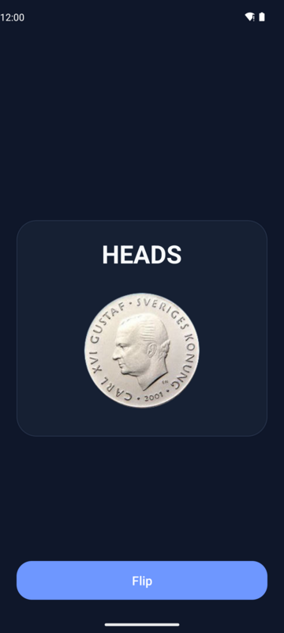
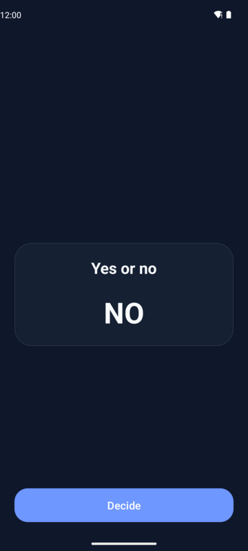
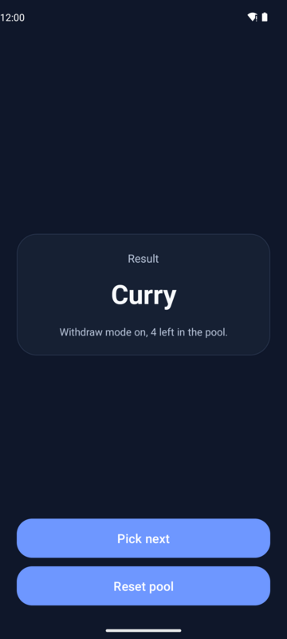
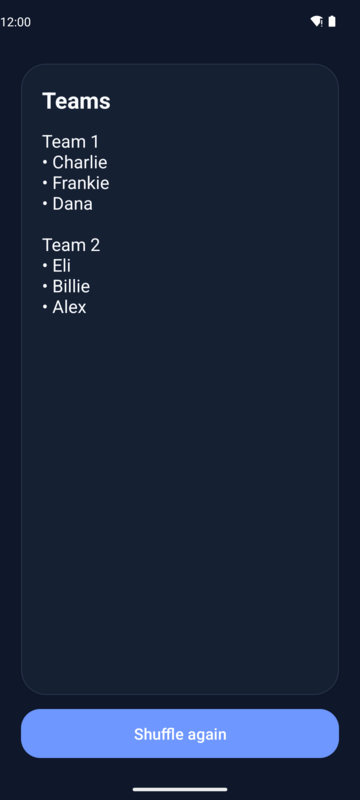

# Randomizer

Flip a coin, roll dice, pick from a list, split teams and more. A small Android app for everyday random decisions, with light and dark themes.

## Features

| Coin | Dice | Yatzy dice | Yes or no |
| :---: | :---: | :---: | :---: |
|  |  |  |  |
| Flip heads or tails. | Roll a single die. | Roll five dice and tap dice to hold them between rolls. | Get a yes or no answer. |

| Categories | Team randomizer | Number generator |
| :---: | :---: | :---: |
|  |  |  |
| Pick one of your own options. Withdraw mode removes picks from the pool until it is reset. | Shuffle players into even teams. | Pick a whole number between a minimum and a maximum. |

Your categories, players and number range are remembered between sessions.

## Installation

Download `randomizer-debug.apk` from the latest [release](https://github.com/carlbodin/randomizer-android/releases) and open it on your Android device (Android 5.0 or newer). Allow "Install unknown apps" for the app you open the APK from. The APK can be deleted after installation.

## Building

Requires JDK 17 or newer and the Android SDK (platform 36).

```sh
./gradlew :app:assembleDebug        # app/build/outputs/apk/debug/randomizer-debug.apk
./gradlew :app:testDebugUnitTest    # unit tests
```

Every push to `main` builds the debug APK and updates the release above.
