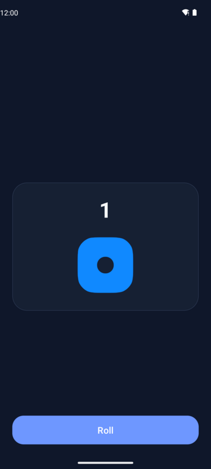
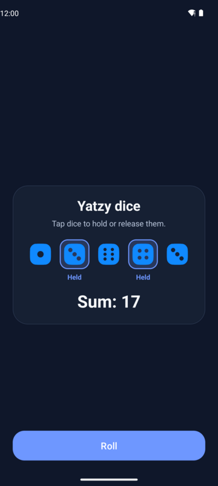
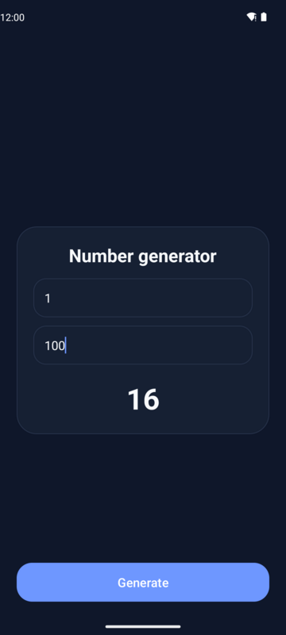

<picture>
  <source media="(prefers-color-scheme: dark)" srcset="docs/readme-assets/icon-dark.png">
  
</picture>

# Randomizer

Flip a coin, roll dice, pick from a list, split teams and more. A small Android app for everyday random decisions, with light and dark themes.

## Features

- **Coin**: flip heads or tails.
- **Dice**: roll a single die.
- **Yatzy dice**: roll five dice and tap dice to hold them between rolls.
- **Categories**: pick one of your own options. Withdraw mode removes picks from the pool until it is reset.
- **Team randomizer**: shuffle players into even teams.
- **Number generator**: pick a whole number between a minimum and a maximum.

Your categories, players and number range are remembered between sessions.

<p align="center">
  
  
  
  
  
  
</p>

## Installation

Download `randomizer-debug.apk` from the latest [release](https://github.com/carlbodin/randomizer-android/releases) and open it on your Android device (Android 6.0 or newer). Allow "Install unknown apps" for the app you open the APK from. The APK can be deleted after installation.

## Building

Requires JDK 17 or newer and the Android SDK (platform 37.2).

```sh
./gradlew :app:assembleDebug        # app/build/outputs/apk/debug/randomizer-debug.apk
./gradlew :app:testDebugUnitTest    # unit tests
```

Every push to `main` builds the debug APK and updates the release above.
